  <h1>  Hi, I'm Gülseher ✨</h1>

🧠 Computer Engineering student  
🎮 As a Junior Game Developer, I'm creating games for fun and learning  
💖 I love every project I work on!  

<h2></h2>

 

<h2></h2>

 
<picture>
  <source media="(prefers-color-scheme: dark)" srcset="https://raw.githubusercontent.com/glshryldrm/glshryldrm/output/pacman-contribution-graph-dark.svg">
  
</picture>

###

